# Results and Validation Report

Auto-generated by `run_pipeline.py`. Every number below comes from the processed dataset.

## Parameters
- Section capacity: **50 students/section** (model parameter, not a dataset variable)
- First-time demand growth: 0.0% per year
- Additional sections available (Model 2): 50
- Planning year: 2023; SD calibrated on 2021→2022

## 1. Dataset validation
|                |   expected |   observed | match   |
|:---------------|-----------:|-----------:|:--------|
| records        |     464739 |     464739 | True    |
| students       |      39364 |      39364 | True    |
| courses        |       4989 |       4989 | True    |
| programmes     |        163 |        163 | True    |
| academic_years |          3 |          3 | True    |

## 2. Descriptive statistics by year
|    |   academic_year |   records |   students |   courses |   programmes |   mean_grade |   fail_rate |   not_evaluated_rate |   pass_rate |   repeat_rate |
|---:|----------------:|----------:|-----------:|----------:|-------------:|-------------:|------------:|---------------------:|------------:|--------------:|
|  0 |            2018 |    152446 |      20233 |      3747 |          124 |        6.387 |       0.178 |                0.083 |       0.739 |       nan     |
|  1 |            2021 |    153120 |      20264 |      3859 |          140 |        6.411 |       0.175 |                0.095 |       0.729 |       nan     |
|  2 |            2022 |    159173 |      20427 |      3787 |          142 |        6.337 |       0.186 |                0.097 |       0.717 |         0.084 |

Repeat enrolments in 2022: **13,446** (8.4% of enrolments); 5,474 students (26.8%) retook at least one course.

## 3. Student progression (2021 → 2022)
| from_stage   |   Graduated |   Progress |   Repeat |   Withdrawn |   Total |   Progress % |   Repeat % |   Graduated % |   Withdrawn % |   new_entrants |   Intake (new + re-entry) |
|:-------------|------------:|-----------:|---------:|------------:|--------:|-------------:|-----------:|--------------:|--------------:|---------------:|--------------------------:|
| Year 1       |          10 |       3314 |      354 |        1359 |    5037 |         65.8 |        7.0 |           0.2 |          27.0 |           3768 |                      3858 |
| Year 2       |           0 |       2474 |      232 |         156 |    2862 |         86.4 |        8.1 |           0.0 |           5.5 |            104 |                       523 |
| Year 3       |           4 |       2832 |      340 |         132 |    3308 |         85.6 |       10.3 |           0.1 |           4.0 |             62 |                       531 |
| Year 4+      |           0 |        162 |       27 |          10 |     199 |         81.4 |       13.6 |           0.0 |           5.0 |              8 |                        10 |
| Final year   |        3623 |          0 |     3889 |        1346 |    8858 |          0.0 |       43.9 |          40.9 |          15.2 |           1047 |                      1881 |

## 4. System Dynamics validation
### 4a. Student-flow stocks (split-half: rates from half A, predict half B)
|            |   observed |   predicted |   abs_pct_error |
|:-----------|-----------:|------------:|----------------:|
| Year 1     |    2402.00 |     2426.10 |            1.00 |
| Year 2     |    1539.00 |     1500.70 |            2.49 |
| Year 3     |    1596.00 |     1609.90 |            0.87 |
| Year 4+    |      89.00 |      109.10 |           22.58 |
| Final year |    4628.00 |     4593.70 |            0.74 |
| Graduated  |    1839.00 |     1835.30 |            0.20 |
| Withdrawn  |    1483.00 |     1501.10 |            1.22 |

Mean absolute percentage error across stocks/exits: **4.2%**.

### 4b. Repeat-demand flow (split-half, per course)
- Course-specific retake rates: R² = **0.909**, MAE = 0.77 students/course, total bias = +6.8%
- Single university-wide rate: R² = 0.743, MAE = 1.13, total bias = +2.1%
- Course-specific rates explain far more between-course variation; their small upward bias errs toward providing capacity (conservative for planning).

## 5. Projected demand 2023
- Total course demand: **161,620** seats (145,727 first-time + 15,893 repeat)

## 6. Bottlenecks (demand ≥ modelled capacity)
- Courses modelled: 3,787; **bottlenecks: 68**; at risk (≥90%): 267
- Projected unmet demand at current modelled sections: **436 students**
- Extra sections needed to clear every bottleneck: 67; programmes affected: 28
- Repeat share of demand in bottleneck courses: 16.4%

Top 10 bottleneck courses:
| course_id    | programme_id   |   enrolment |   demand |   demand_repeat |   current_capacity |   utilisation |   unmet_demand |   extra_sections_needed |
|:-------------|:---------------|------------:|---------:|----------------:|-------------------:|--------------:|---------------:|------------------------:|
| 024e9489dcc6 | 1d0ebea552eb   |         288 |   346.87 |           58.87 |                300 |          1.16 |          46.87 |                       1 |
| 55c753e07b45 | 1d0ebea552eb   |         246 |   291.99 |           45.99 |                250 |          1.17 |          41.99 |                       1 |
| 7741d341a4ef | d6a403173361   |         148 |   173.36 |           61.36 |                150 |          1.16 |          23.36 |                       1 |
| 0d9a5484f79e | d6a403173361   |         293 |   320.85 |           94.85 |                300 |          1.07 |          20.85 |                       1 |
| fc6b5f835bfb | f57e5cb1f453   |         193 |   218.39 |           25.39 |                200 |          1.09 |          18.39 |                       1 |
| d1710e41e0ad | 1d0ebea552eb   |         247 |   266.87 |           19.87 |                250 |          1.07 |          16.87 |                       1 |
| 9fad9fb565cc | 1d0ebea552eb   |         248 |   266.00 |           37.00 |                250 |          1.06 |          16.00 |                       1 |
| 21049fe0067f | d6a403173361   |         288 |   315.66 |           88.66 |                300 |          1.05 |          15.66 |                       1 |
| 6cf57950d3bb | 01d54579da44   |         323 |   364.55 |           89.55 |                350 |          1.04 |          14.55 |                       1 |
| 952808c9e122 | 734d0759cdb4   |         150 |   162.49 |           56.49 |                150 |          1.08 |          12.49 |                       1 |

## 7. Model 1 – Minimum Section Allocation
- **Decision variable:** x_c = sections opened for course c (integer ≥ 1)
- **Objective:** minimise Σ_c x_c — the total number of sections opened
- **Target:** every student seated — cap·x_c ≥ D_c for every course
- **Measure of effectiveness:** unmet demand = **0 students** (coverage achieved 100.00%; courses short: 0)
- Minimum sections to meet all demand: **5,612** (modelled current: 5,570)
- Courses needing more sections: 67 (+67); courses that can release sections: 25 (−25)
- LP relaxation: 5,062.3 fractional sections → integrality gap 549.7 sections
- Mean utilisation of allocated seats: 57.6%; all integer: True; demand fully met: True
- Solver: Optimization terminated successfully. (HiGHS Status 7: Optimal)

## 8. Model 2 – Limited Additional Capacity Allocation
- **Decision variable:** y_ck ∈ {0,1} = open the k-th extra section for course c?
- **Objective:** maximise Σ_c Σ_k w_c·a_ck·y_ck — weighted demand covered
- **Target:** budget ceiling Σ y_ck ≤ B = 50 sections
- **Measure of effectiveness:** unmet demand 436 → **9 students**
- Budget: 50 sections; used 50 across 50 courses
- Unmet demand: 436 → **9** students (98.0% reduction); courses still short: 67 → 17
- With a fairness cap of 5 extra sections per programme: unmet after = 20
- Repeat-weighted priority: unmet after = 9

## 9. Sensitivity analysis
### Section capacity
|   capacity |   bottleneck_courses |   at_risk_courses |   unmet_demand_status_quo |   current_sections_modelled |   model1_sections |   lp_relaxation_sections |   model1_utilisation |   extra_sections_to_clear |
|-----------:|---------------------:|------------------:|--------------------------:|----------------------------:|------------------:|-------------------------:|---------------------:|--------------------------:|
|         30 |                133.0 |             472.0 |                     639.1 |                      7444.0 |            7533.0 |                   6700.5 |                  0.7 |                     135.0 |
|         40 |                 86.0 |             345.0 |                     340.9 |                      6229.0 |            6278.0 |                   5646.2 |                  0.6 |                      86.0 |
|         50 |                 68.0 |             267.0 |                     436.5 |                      5570.0 |            5612.0 |                   5062.3 |                  0.6 |                      67.0 |
|         60 |                 48.0 |             206.0 |                     254.1 |                      5172.0 |            5200.0 |                   4697.0 |                  0.5 |                      48.0 |
|         75 |                 38.0 |             202.0 |                     245.1 |                      4733.0 |            4752.0 |                   4367.5 |                  0.5 |                      38.0 |
|        100 |                 31.0 |             128.0 |                     219.8 |                      4324.0 |            4337.0 |                   4099.0 |                  0.4 |                      31.0 |
### Additional sections (Model 2)
|   extra_sections |   extra_sections_used |   unmet_demand_after |   demand_covered |   unmet_reduction_pct |   courses_short_after |   marginal_coverage_per_section |
|-----------------:|----------------------:|---------------------:|-----------------:|----------------------:|----------------------:|--------------------------------:|
|                0 |                   0.0 |                436.5 |              0.0 |                   0.0 |                  67.0 |                           nan   |
|                5 |                   5.0 |                285.0 |            151.5 |                  34.7 |                  62.0 |                            30.3 |
|               10 |                  10.0 |                209.4 |            227.0 |                  52.0 |                  57.0 |                            15.1 |
|               25 |                  25.0 |                 83.9 |            352.6 |                  80.8 |                  42.0 |                             8.4 |
|               50 |                  50.0 |                  8.8 |            427.7 |                  98.0 |                  17.0 |                             3.0 |
|               75 |                  67.0 |                  0.0 |            436.5 |                 100.0 |                   0.0 |                             0.3 |
|              100 |                  67.0 |                  0.0 |            436.5 |                 100.0 |                   0.0 |                             0.0 |
|              150 |                  67.0 |                  0.0 |            436.5 |                 100.0 |                   0.0 |                             0.0 |
|              200 |                  67.0 |                  0.0 |            436.5 |                 100.0 |                   0.0 |                             0.0 |
|              300 |                  67.0 |                  0.0 |            436.5 |                 100.0 |                   0.0 |                             0.0 |
### First-time demand growth
| growth   |   projected_demand |   bottleneck_courses |   unmet_demand_status_quo |   unmet_after_model2 |   extra_sections_to_clear |
|:---------|-------------------:|---------------------:|--------------------------:|---------------------:|--------------------------:|
| -5%      |           154333.9 |                 30.0 |                     162.4 |                  0.0 |                      30.0 |
| 0%       |           161620.2 |                 68.0 |                     436.5 |                  8.8 |                      67.0 |
| +2%      |           164534.8 |                108.0 |                     650.8 |                 83.6 |                     109.0 |
| +5%      |           168906.6 |                169.0 |                    1189.7 |                354.9 |                     171.0 |
| +10%     |           176192.9 |                268.0 |                    2620.9 |               1240.8 |                     270.0 |

## 10. Scenario comparison (2023–2027)
| scenario                   | policy     |   capacity | growth   |   extra_sections | pass_rate_shift   |   first_year_demand |   first_year_unserved |   cumulative_unserved |   mean_sections_per_year |   mean_utilisation |   final_backlog |   final_year_demand |
|:---------------------------|:-----------|-----------:|:---------|-----------------:|:------------------|--------------------:|----------------------:|----------------------:|-------------------------:|-------------------:|----------------:|--------------------:|
| S0 Status quo              | status_quo |         50 | 0%       |                0 | 0%                |            161620.2 |                 436.5 |                3389.5 |                   5570.0 |                0.6 |         46819.2 |            162082.0 |
| S1 Limited extra (Model 2) | model2     |         50 | 0%       |               50 | 0%                |            161620.2 |                   8.8 |                  94.5 |                   5620.0 |                0.6 |         46347.9 |            161877.1 |
| S2 Double budget (Model 2) | model2     |         50 | 0%       |              100 | 0%                |            161620.2 |                   0.0 |                   0.0 |                   5644.6 |                0.6 |         46329.2 |            161872.2 |
| S3 Full coverage (Model 1) | model1     |         50 | 0%       |                0 | 0%                |            161620.2 |                   0.0 |                   0.0 |                   5613.0 |                0.6 |         46329.2 |            161872.2 |
| S4 Model 2 + pass +5pp     | model2     |         50 | 0%       |               50 | +5%               |            161620.2 |                   8.8 |                  12.8 |                   5620.0 |                0.6 |         37453.7 |            158852.7 |
| S5 Model 2, intake +5%/yr  | model2     |         50 | +5%      |               50 | 0%                |            168906.6 |                 354.9 |               29344.6 |                   5620.0 |                0.6 |         69124.4 |            207578.8 |

## Figures
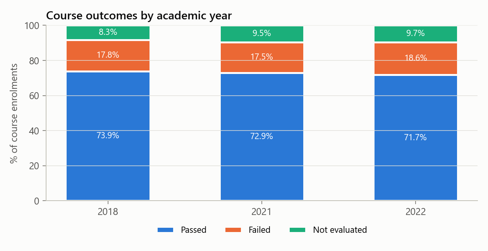
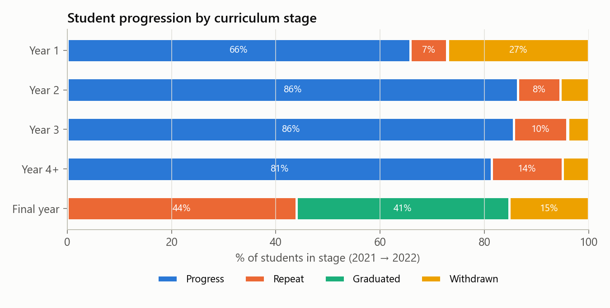
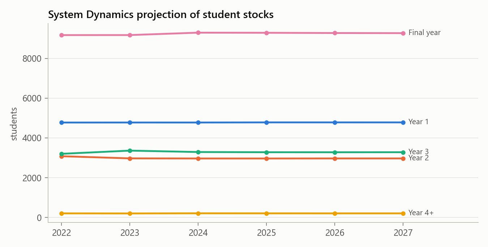
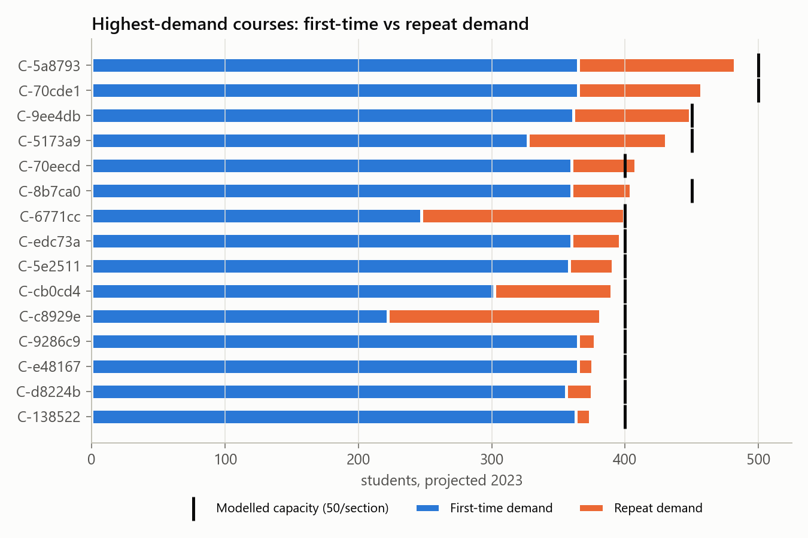
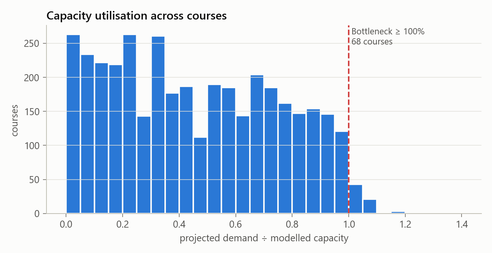
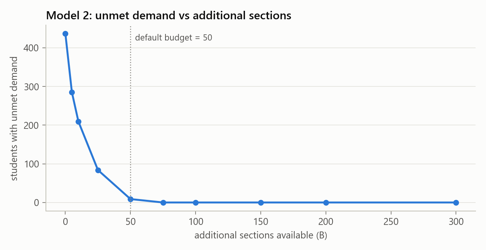
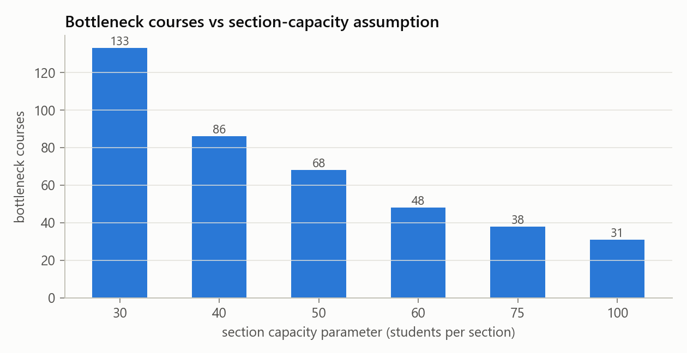
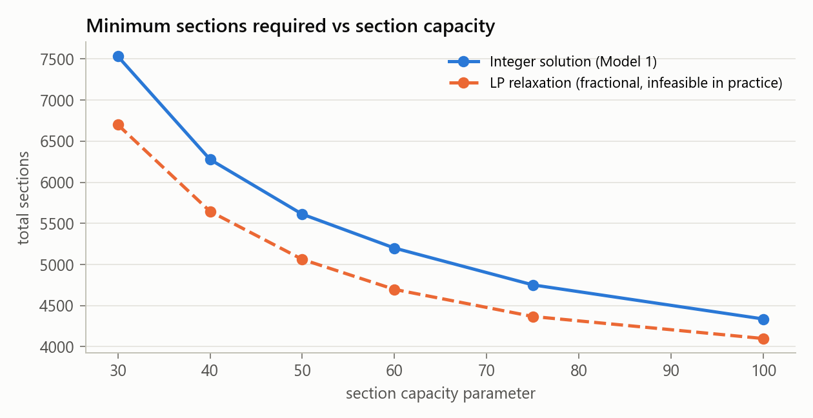
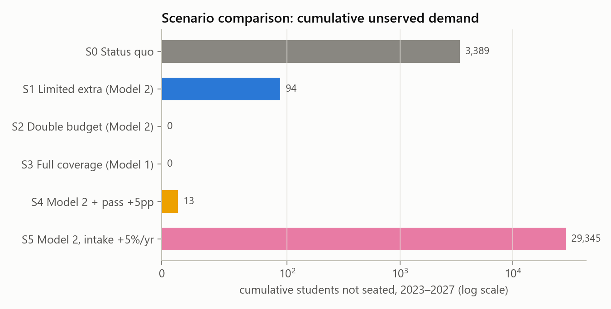
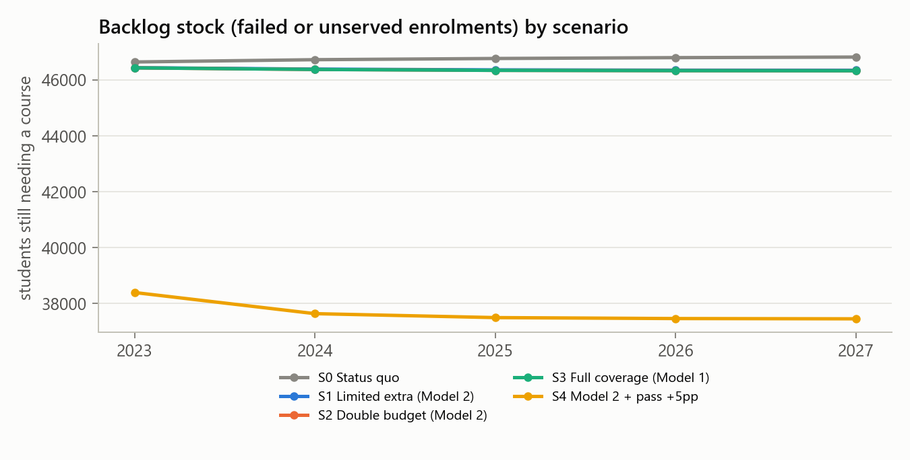
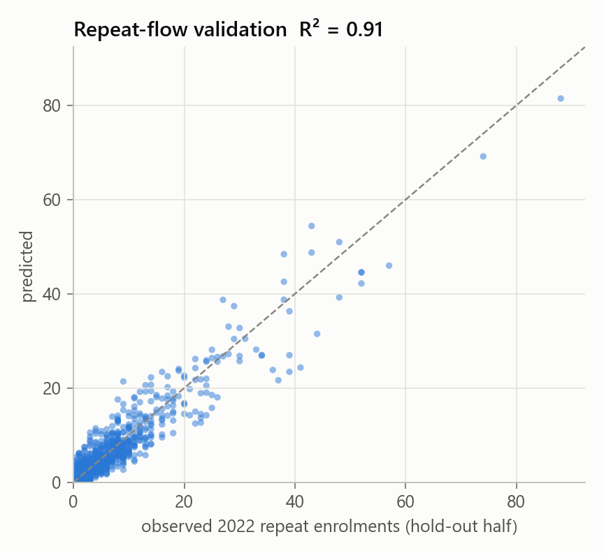